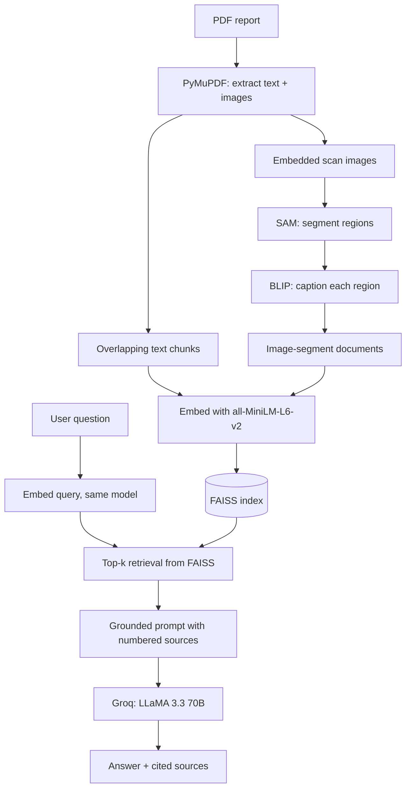

# Medical Document Intelligence System

A multimodal Retrieval-Augmented Generation (RAG) pipeline that lets you ask plain-English questions about medical PDFs, including the scan images embedded in them, and get answers with cited sources.

Built entirely in Google Colab with free tools: SAM for image segmentation, BLIP for captioning, sentence-transformers and FAISS for retrieval, and Groq (LLaMA 3.3 70B) for generation.

> **Disclaimer:** This is an educational portfolio project. It is not a medical device and must not be used for clinical decisions. The demo uses a synthetic sample report and a synthetic scan image.

---

## The problem

Medical PDFs contain two kinds of information: text (findings, diagnoses, medications) and images (X-rays, CT, MRI). Finding one fact across many reports means opening every file and reading every page. Standard RAG handles only the text and ignores the scans.

This project indexes both. Scan images are segmented, each region is captioned into text, and those captions are searched in the same vector index as the report text.

## How it works



**Key idea:** images become text before indexing, so one similarity search retrieves both text passages and image-region captions.

## Features

- PDF parsing with PyMuPDF: text extraction plus embedded image extraction
- Word-based chunking with overlap (250 words, 50 overlap) so boundary sentences are never lost
- Zero-shot segmentation of scans with Segment Anything (SAM, ViT-B), with confidence and stability filtering
- Conditional region captioning with BLIP using a medical prompt prefix
- 384-dimensional semantic embeddings, L2-normalised, stored in a FAISS `IndexFlatIP` (cosine similarity)
- Optional filtering of retrieval by document type (`text` or `image_segment`)
- Grounded prompting: answer only from context, cite sources, admit when information is missing
- Evaluation: Precision@k for retrieval and a lexical faithfulness score for answers
- Gradio web demo with a shareable link

## Tech stack

| Stage | Tool |
| --- | --- |
| PDF parsing | PyMuPDF (`fitz`) |
| Segmentation | Segment Anything Model, `sam_vit_b_01ec64` |
| Image captioning | BLIP, `Salesforce/blip-image-captioning-base` |
| Embeddings | `sentence-transformers/all-MiniLM-L6-v2` |
| Vector search | FAISS (`faiss-cpu`, `IndexFlatIP`) |
| LLM | Groq API, `llama-3.3-70b-versatile` |
| UI | Gradio |
| Environment | Google Colab + Google Drive for persistence |

## Repository structure

The project is split into five notebooks. Each one is self-contained (own install cell) and passes its outputs to the next through Google Drive.

| Notebook | Purpose | Saves to Drive |
| --- | --- | --- |
| `01_setup_and_pdf_parsing.ipynb` | Mount Drive, create or load the PDF, chunk text, extract images | `text_chunks.pkl`, `image_infos.pkl`, `images/` |
| `02_image_segmentation.ipynb` | SAM segmentation and BLIP captioning of extracted images | `image_docs.pkl`, `segmentation_viz.png` |
| `03_embedding_and_indexing.ipynb` | Embed all documents, build and save the FAISS index | `faiss.index`, `all_docs.pkl`, `config.pkl` |
| `04_rag_with_groq.ipynb` | Retrieval, prompt building, Groq generation | `rag_results.json` |
| `05_evaluation_and_demo.ipynb` | Precision@k, faithfulness, Gradio demo | `eval_precision.png`, `eval_summary.png` |

## Getting started

### Prerequisites

- A Google account (Colab and Drive)
- A free Groq API key from [console.groq.com](https://console.groq.com)
- A GPU runtime is recommended for notebook 2 (Runtime > Change runtime type > T4 GPU)

### Setup

1. Upload the five notebooks to Colab.
2. In Colab, open the key icon (Secrets) in the left sidebar and add a secret named `GROQ_API_KEY` with your key. Enable notebook access.
3. Run the notebooks in order, 1 to 5. Each notebook's first cell mounts Drive and writes to `MyDrive/medical_rag`.
4. To use your own report instead of the synthetic sample, upload a PDF in notebook 1 and set `PDF_PATH` to its filename.

## Example queries

```text
What was found in the CT scan and where exactly?
What medications were prescribed and at what dosage?
Describe what the scan image shows           # filter: image_segment
What is the patient's blood pressure reading? # not in the document -> should say so
```

Each answer includes the retrieved sources with page, type (`text` or `image_segment`) and similarity score.

## Evaluation

Two failure modes are measured separately:

- **Precision@k (retrieval):** for each test query, does a known keyword appear in the top 1, 2, 3 or 5 retrieved chunks?
- **Faithfulness (generation):** what fraction of the answer's content words appear in the retrieved context? This is a lexical proxy, not a logical-entailment check.

Results from running notebook 5 on the synthetic sample report:

| Metric | Result |
| --- | --- |
| Precision@1 | 62% (5 of 8 queries) |
| Precision@2 | 75% (6 of 8) |
| Precision@3 | 75% (6 of 8) |
| Precision@5 | 75% (6 of 8) |
| Faithfulness, 3 test queries | 79%, 88%, 14% (mean about 60%) |

Two retrieval queries missed even at k=5: "What does the scan show?" (expected keyword `nodule`) and "Who is the radiologist?" (expected keyword `sharma`). The 14% faithfulness score on "What did the CT scan reveal?" is under investigation: the lexical metric penalises refusals and heavy paraphrase as well as genuine hallucination, so the answer needs to be read before drawing conclusions.

The evaluation set is small (8 hand-written queries against one synthetic report), so treat these numbers as a sanity check rather than a benchmark.

## Design decisions

- **RAG over fine-tuning:** knowledge lives in an index that can be updated by re-embedding, with no retraining.
- **SAM over a trained U-Net:** SAM is zero-shot, so no labelled medical dataset is needed. It does not know what a nodule is, which is why BLIP adds semantics.
- **One index for text and images:** a single search returns whichever modality is most relevant.
- **Same embedding model for documents and queries:** the model name is saved in `config.pkl` so every notebook loads the same one.
- **Temperature 0.2:** near-deterministic output for factual Q&A.
- **FAISS `IndexFlatIP`:** exact search, fast enough at this scale.

## Limitations

- The demo data is synthetic. SAM and BLIP behaviour on real clinical scans is untested here, and generic BLIP captions can be inaccurate for medical images.
- The faithfulness metric checks word overlap only. It cannot detect negation or wrong claims that reuse the right words.
- Retrieval evaluation uses a tiny keyword-based test set.
- No re-ranking, no conversation memory, and state is stored in pickle files.
- Not validated for clinical use.

## Future work

- Cross-encoder re-ranker on the top candidates from FAISS
- Hybrid search combining dense retrieval with BM25 for exact terms such as drug names and ICD codes
- NLI-based faithfulness scoring
- Conversational memory for follow-up questions
- Approximate search (`IndexIVFFlat` or HNSW) and a managed vector database for larger collections
- Evaluation on real, de-identified clinical documents

## Acknowledgements

[Segment Anything](https://github.com/facebookresearch/segment-anything) (Meta AI), [BLIP](https://huggingface.co/Salesforce/blip-image-captioning-base) (Salesforce), [sentence-transformers](https://www.sbert.net), [FAISS](https://github.com/facebookresearch/faiss) (Meta AI), [Groq](https://groq.com), [Gradio](https://www.gradio.app).

## License

Add a license of your choice (for example MIT) before publishing.
